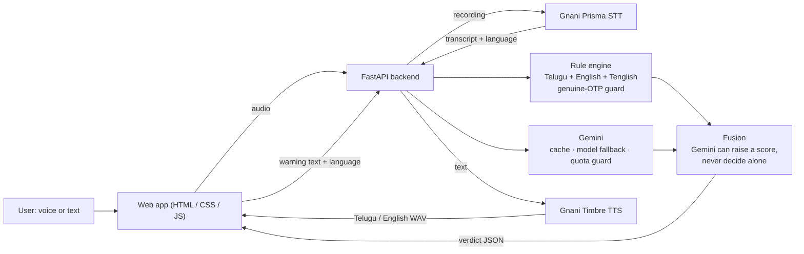

# 🛡️ CyberShield Voice AI

**Speak or paste a suspicious message. Get a verdict, the reasons, and a spoken warning in Telugu or English.**

Built for the Gnani.ai *Great Indian AI Internship Challenge*. The idea: many Indians get scam
calls, WhatsApp voice notes and SMS in **Telugu**, and most scam checkers only read English text.
CyberShield is **voice-first**: a recording goes in, a spoken warning in the speaker's language comes out.

<p align="center">
  <br>
  <em>UI capture from a local test run (Gnani and Gemini calls were stubbed for the capture, so the timings shown are not real).</em>
</p>

## How Gnani AI is used (core of the product, not an add-on)

| Step | Gnani product | What it does here |
|---|---|---|
| 1. Listen | **Prisma STT** | Turns a Telugu / English recording (≤ 30 s) into text and auto-detects the language. Browser recordings are converted to 16 kHz WAV first. |
| 2. Decide | rules + Gemini | Scam verdict (see below) |
| 3. Warn | **Timbre TTS** | Speaks a warning written for *this* message, **in the language the speaker used** (Telugu voice for Telugu audio). A voice scan plays it automatically. |

The result page shows a **"How this result was produced"** strip with the time each stage took
(Prisma → rules → Gemini → Timbre), so the Gnani steps are visible, not hidden.

## Architecture



## How the verdict is decided (not a plain average)

1. **Rule engine** (`backend/services/threat_engine.py`): specific Indian scam patterns (OTP, KYC, digital arrest,
   UPI collect, fake jobs, electricity, loan, courier, prize, remote access, refund, family emergency…) in Telugu,
   English and Tenglish; a *signal-combination* layer (two or more different scam ingredients together, one alone never
   counts, capped at MEDIUM); and a **genuine-OTP guard** so a real "Do not share this code" message stays LOW.
2. **Gemini** gives an independent opinion (threat type, confidence, explanation, voice script).
3. **Fusion** (`combine_verdicts`): Gemini can only **raise** the score.
   Rules found something and Gemini strongly agrees → **HIGH**. Rules found nothing → Gemini alone reaches **MEDIUM at most**,
   so an AI mistake or a prompt-injected message cannot create a HIGH alert alone. A genuine-OTP notice always stays LOW.
   If Gemini is unavailable the rule result is shown and nothing breaks.

## Measured accuracy: rules only (no Gemini)

Scam = MEDIUM/HIGH, genuine = LOW. Reproduce: `python -m tests.run_benchmark`.
All messages were written by the project author (184 in total: 92 scam, 92 genuine; Telugu, English, Tenglish, tricky genuine alerts).

| Message set | n | Precision | Recall | False-positive rate | Note |
|---|---|---|---|---|---|
| DEV / HELD-OUT / HARD | 81 | 100% | 100% | 0% | used while designing patterns, **not evidence** |
| BLIND, first run | 24 | 100% | 33.3% | 0% | before tuning on it |
| BLIND2, first run | 24 | 100% | 41.7% | 0% | before tuning on it |
| BLIND3, first run | 31 | 83.3% | 66.7% | 12.5% | the 2 false alarms were genuine-OTP guard bugs, fixed afterwards |
| **BLIND4 (new scam types, run once, never tuned on)** | **24** | **100%** | **41.7%** | **0%** | **the honest generalisation number** |
| All 184 after fixes | 184 | 100% | 88.0% | 0% | optimistic: most sets were tuned on |

**Honest reading.** The rules almost never raise a false alarm (0 of 92 genuine messages), but on scam types they
have never seen they catch only about **40-55%**. That is exactly why Gemini is part of the pipeline.
The benchmark is small and self-written, so treat the numbers as indicative, not as a production accuracy claim.

## Measured accuracy: rules + Gemini (the real pipeline)

Same scoring (scam = MEDIUM/HIGH). Run on the code described here, without changing the detector between runs.

| Test set | n | Precision | Recall | False-positive rate | Counts |
|---|---|---|---|---|---|
| BLIND4, rules + Gemini | 24 | 100% | 100% | 0% | TP 12 FN 0 FP 0 TN 12. BLIND4 is **no longer blind** (its misses were seen after the rules-only run). |
| **Fresh messages from 5 other people**, rules + Gemini, all | 30 | 88.2% | 100% | **13.3%** | TP 15 FN 0 FP 2 TN 13 |
| same, excluding 4 debatable labels | 26 | 92.3% | 100% | 7.1% | TP 12 FN 0 FP 1 TN 13 |
| same fresh set, **rules only**, all | 30 | 100% | 53.3% | 0% | TP 8 FN 7 FP 0 TN 15 |
| same, rules only, excluding the 4 debatable | 26 | 100% | 66.7% | 0% | TP 8 FN 4 FP 0 TN 14 |

**Honest reading.** Gemini closes the recall gap on messages written by other people (all 15 scams caught, including the 7
the rules missed), but it also adds false alarms: 2 of 15 genuine messages, one of them a legitimate SBI debit alert
(rated MEDIUM, never HIGH, because Gemini alone is capped at MEDIUM). With only 15 genuine messages the true false-alarm
rate could be anywhere from roughly 4% to 38%, and with 15 scams "100% recall" could hide a true rate near 80%.

About the fresh set (`research/raw_messages.txt`): 30 messages from 5 contributors, **mostly English** (one Tenglish message, no
Telugu script, so it is **not** a Telugu test). Labels were given by the contributors and are not independently verified, four
are debatable (promotions or ambiguous alerts), several messages look like real SMS pasted with personal details masked, and
links were redacted (which makes scams harder to spot). Full per-message results are in `research/evaluation_results.txt`
(rules only) and `research/evaluation_results_hybrid.txt` (rules + Gemini). Reproduce with
`python -m tests.run_fresh_benchmark` and `python -m tests.run_fresh_benchmark --hybrid` (the second one uses Gemini quota and asks first).
Gemini answers can vary between runs and model versions.

### Voice benchmark (Prisma on real recordings)

20 scripted sentences (`tests/audio/labels.csv`; 10 Telugu, 10 English; 10 scam, 10 genuine) were read aloud by the author:
**one speaker, one microphone**. The recordings are not published (personal voice); anyone can record their own and run
`python -m tests.run_voice_benchmark`. 19 clips were processed in the benchmark run (one failed with a temporary connection error
and is not counted). Using Prisma's transcript and the rules only:
**precision 100%, recall 90%, F1 94.7%, false-positive rate 0%** (TP 9, FN 1, FP 0, TN 9).

Findings, stated plainly:
- One Telugu scam (police impersonation) was missed. Prisma wrote the word for "arrest" as `అరెస్టు`, while the rule expects `అరెస్ట్`; with that one spelling difference only one scam signal remained, and the combination layer needs two. Spelling variants between speech output and the rules are a known gap and are **not fixed**.
- For three short English genuine clips, Prisma's `indic-auto` mode detected Telugu and wrote the English words in Telugu script. They stayed LOW (correct), but a scam spoken that way could be missed by the English rules. Choosing the language explicitly avoids this.
- **Word error rate is not reported.** The script's tokeniser split Telugu words at vowel signs and compared transliterated text with English references, so its WER figures (hundreds of percent) are not valid.

## Automated tests

| Command | What it checks | Status |
|---|---|---|
| `python -m tests.run_benchmark` | detection metrics on 184 messages | passes |
| `python -m tests.test_fusion` | Gemini + rules fusion rules (8 cases) | 8/8 |
| `python -m tests.test_api` | all endpoints, response structure, limits, rate limit, CORS (18 checks, Gnani faked) | 18/18 |
| `python -m tests.test_gemini_resilience` | model fallback, 404/429/503, quota memory, cache, off-switch against a local fake Gemini server (9 checks) | 9/9 |
| `python -m tests.run_fresh_benchmark [--hybrid]` | rules (and rules + Gemini) on 30 messages from 5 contributors; writes `research/evaluation_results*.txt` | baseline report, not pass/fail |

Real Gnani Prisma / Timbre calls and real Gemini calls are exercised by hand on the author's machine; they are not part of the automated tests.

## Reliability and security

- **Gemini free tier:** result cache, automatic fallback between models, memory of quota (no wasted calls after a 429),
  retired-model (404) and overload (503) handling, 12 s timeout, IPv4-only connection (fixes ~100 s hangs seen on some networks).
- **Per-IP rate limit** on analyze/speak endpoints (`RATE_LIMIT_PER_MIN`, default 30), input size limits, audio type and size checks.
- **API keys** only in `.env` / host environment, never in the repo. `CORS_ORIGINS` can restrict browser origins.
- **Privacy:** message text is sent to Gemini for analysis and audio to Gnani Prisma; scan history is stored locally (SQLite) and can be deleted in the app.

## Run it locally (Windows PowerShell, one command at a time)

```
cd CyberShield-Voice-AI
python -m venv .venv
.venv\Scripts\activate
python -m pip install -r requirements.txt
copy .env.example .env        # open .env and add GNANI_API_KEY and GEMINI_API_KEY
python -m uvicorn backend.main:app --host 127.0.0.1 --port 8000
```

Open **http://127.0.0.1:8000/app/** (the backend serves the page, one URL). Developing with VS Code Live Server
(`frontend/index.html` on port 5500) also still works. Restart uvicorn after backend code changes.

Health check: http://127.0.0.1:8000/health · API docs: http://127.0.0.1:8000/docs

## Deploy a public demo (Render, free tier)

`render.yaml` is included. Push the repo to GitHub → Render → *New* → *Blueprint* → choose the repo → add
`GNANI_API_KEY` and `GEMINI_API_KEY` in *Environment*. Public URL: `https://<your-service>.onrender.com/app/`.
The free tier sleeps when idle (first load can take ~1 min) and its disk is temporary (history resets). *Not yet deployed or tested on Render.*
Keep `RATE_LIMIT_PER_MIN` low on a public demo so visitors cannot use up your Gnani credits and Gemini quota.

## API

| Method | Path | Purpose |
|---|---|---|
| GET | `/health` | status of Gnani / Gemini / rules |
| POST | `/api/analyze-text` | `{ "text": "..." }` → `analysis`, `rule_analysis`, `ai_analysis`, `pipeline` |
| POST | `/api/analyze-audio` | audio file → Prisma transcript → same result + `transcription`, `pipeline.stt_ms` |
| POST | `/api/speak` | `{ "text", "language" }` → Timbre WAV |
| GET/POST/DELETE | `/api/history` | scan history |
| POST | `/api/report-pdf` | PDF report |
| POST | `/api/scan-url` | offline URL structure check |
| POST | `/api/emergency-guidance` | recovery steps |

## Project structure

```
backend/   main.py · config.py · security.py · features.py · fonts/ (Noto Sans Telugu, SIL OFL)
           services/ prisma_service.py · timbre_service.py · gemini_service.py · threat_engine.py
frontend/  index.html · style.css · script.js · features.js
tests/     benchmark_messages.py · run_benchmark.py · run_voice_benchmark.py · run_hybrid_benchmark.py
           test_fusion.py · test_api.py · test_gemini_resilience.py · audio/ (voice-sample scripts)
docs/      screenshots/ · CHALLENGE_CHECKLIST.md
research/  raw_messages.txt · evaluation_results.txt · evaluation_results_hybrid.txt
warm_cache.py   pre-saves Gemini answers for the demo messages
```

## Limitations

- Assistive tool, **not** a guarantee that a message is safe or fraudulent. URL check is offline structure only.
- Rules alone catch only about 40-55% of unseen scams. With Gemini, recall was 100% on two small sets, but the hybrid also raised false alarms on legitimate bank alerts (2 of 15 genuine messages in the fresh set). All evaluation sets are small and labelled by the author or contributors.
- Telugu: the fresh-message set has almost no Telugu, so Telugu accuracy rests on the author's own messages and 20 voice clips from one speaker. Spelling variants in Telugu speech output can make a rule miss (see voice benchmark).
- PDF reports use the bundled Noto Sans Telugu font (SIL Open Font License); some Telugu conjunct letters are not perfectly joined (a ReportLab limitation).
- Gemini free-tier quota limits how many new messages can be analysed per day (cache and fallback soften this).
- Single-instance demo design: rate limit and cache are in memory.